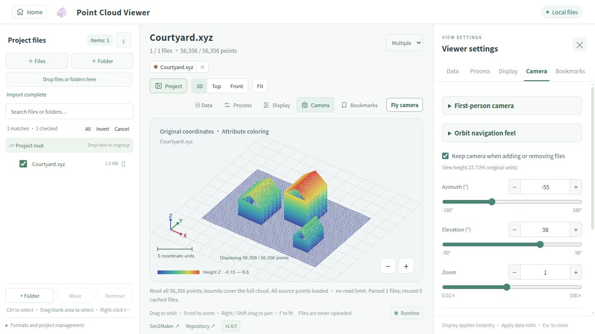

<div align="center">

<h1>BuildingWebViewer</h1>
<p>A local 3D toolbox for meshes, wireframes, point clouds and Gaussian splats, with point-cloud attribute mapping, processing and export.</p>
<p><a href="README.md">简体中文</a> · <strong>English</strong> · <a href="https://sen2maker.github.io/BuildingWebViewer/?lang=en">Try online ↗</a> · <a href="https://github.com/Sen2Maker/BuildingWebViewer/releases/latest">Downloads</a></p>

</div>



## Get started

**Browser** → [Open online](https://sen2maker.github.io/BuildingWebViewer/?lang=en), or download `BuildingWebViewer-Web-vX.Y.Z.zip` from Releases, extract it completely and open `index.html`. Chrome / Edge recommended; no runtime dependencies to install.

**Local server** (optional, Python 3): run in the extracted project directory:

```bash
python3 server.py
```

Open [http://127.0.0.1:8765](http://127.0.0.1:8765). Stop with `Ctrl+C`; use `--port 8766` if the port is busy.

**Android app** → Install the complete Preview APK from the same Release. Existing users can receive compatible web updates; native changes require installing the new APK over the existing app. [Installation and builds](docs/ANDROID.md)

## Tools

| Tool | Input | Key features |
| --- | --- | --- |
| **Mesh Viewer** | Triangulated OBJ meshes | Multi-model layouts, solid / wireframe, relative-height and face-orientation colors |
| **Wireframe Viewer** | OBJ + optional point clouds | Single/multiple IDs, All/Invert, previous/next shortcuts and up to three comparison panes |
| **Point Cloud Viewer** | TXT · XYZ · CSV · PTS · PLY · PCD | Multiple clouds, RGB / HSV / scalar colors, attribute processing and merged export |
| **Gaussian Splatting Viewer** | PLY with 3DGS attributes | Web perspective / orthographic views, SH colors and optional `cameras.json`; native Android full-splat rendering, fly navigation, views and capture |
| **Point Cloud Studio** | Create from scratch or import clouds | Drawing and sampling, rectangle / lasso, cropping, painting, project save and PLY export |

Text clouds load XYZ plus extra columns, such as `x y z intensity`. After import, assign RGB, HSV, normals, intensity or custom labels and reorder exported columns. Processing runs only for the selected operation. [Processing guide](docs/PROCESSING.md)

Wireframe folder example: `dataset / objectID / wireframe.obj, cloud.txt`. Ordinary XYZ points are not Gaussian splats: 3DGS also requires opacity, scale, rotation and color attributes. LAS / LAZ and compressed PCD are not supported.

## Essentials

- **Local processing**: files are not automatically uploaded. Distribution packages contain no user data; app project backups include imported files.
- **Projects and views**: browser file selections and groups are session-only; reselect after refresh. Browser views persist per origin and support JSON import / export. The app stores projects and exports `.bwv.zip` backups. Native Gaussian views and web bookmarks use separate formats.
- **Coordinates and colors**: Mesh Viewer arranges models in display coordinates. Relative height starts at each model’s lowest Z; face-orientation colors do not classify roofs or walls. Cloud overlays require a shared coordinate system; no CRS conversion is performed.
- **Capacity**: point clouds load all points by default, with optional import caps and display ratios. Gaussian viewing retains all source splats and reports capacity failures. The native Gaussian workspace focuses on viewing, navigation and capture; web Gaussian editing is separate.

Switch language on the home page. Mobile browsers support touch; Android is recommended for Gaussian viewing. Exchange `.bwvproject` point-cloud editing projects manually between desktop browsers, mobile browsers and the app. [Cross-platform guide](docs/CROSS_PLATFORM.md)

## Development

The website uses HTML / CSS / JavaScript + WebGL. Edit `src/` and `assets/css/`, not generated `assets/js/` files.

```bash
python3 build.py --site --zip
python3 scripts/check.py  # Node 18+
```

Android builds additionally need Node 22+, a JDK and Android SDK. See [development](docs/DEVELOPMENT.md), [changelog](CHANGELOG.md) and [releases](docs/RELEASING.md).

Desktop [camera animation timeline](docs/CAMERA-ANIMATION.md) in the Mesh Viewer, with keyframes, playback and video export. See [module architecture](docs/ARCHITECTURE.md).
