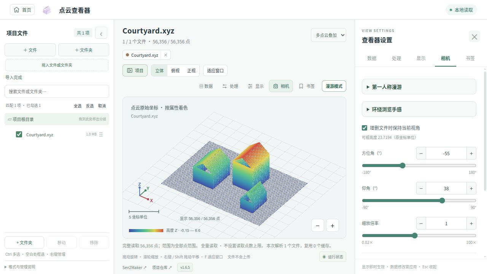

<div align="center">

<h1>BuildingWebViewer</h1>
<p>本地三维数据工具箱：网格、线框、点云与三维高斯可视化，支持点云属性整理、计算和导出。</p>
<p><strong>简体中文</strong> · <a href="README.en.md">English</a> · <a href="https://sen2maker.github.io/BuildingWebViewer/">在线体验 ↗</a> · <a href="https://github.com/Sen2Maker/BuildingWebViewer/releases/latest">下载</a></p>

</div>



## 开始使用

**网页** → [在线打开](https://sen2maker.github.io/BuildingWebViewer/)，或下载 Release 中的 `BuildingWebViewer-Web-vX.Y.Z.zip`，完整解压后双击 `index.html`。推荐 Chrome / Edge，无需安装依赖。

**本地服务**（可选，需要 Python 3）：在解压目录运行：

```bash
python3 server.py
```

打开 [http://127.0.0.1:8765](http://127.0.0.1:8765)，按 `Ctrl+C` 停止；端口占用时加 `--port 8766`。

**Android App** → 下载同一 Release 的完整 Preview APK，允许系统安装。已有用户可接收兼容热更新；原生功能变化需覆盖安装新 APK。[安装与构建](docs/ANDROID.md)

## 工具

| 工具 | 输入 | 关键功能 |
| --- | --- | --- |
| **网格模型查看器 / Mesh Viewer** | OBJ 三角网格 | 多模型排列、实体 / 线框、相对高度与面朝向着色 |
| **线框查看器** | OBJ + 可选点云 | 按对象目录分组，最多三个面板比较、相机同步 |
| **点云查看器** | TXT · XYZ · CSV · PTS · PLY · PCD | 多文件叠加、RGB / HSV 和标量着色、属性计算、合并导出 |
| **三维高斯** | 含 3DGS 属性的 PLY | 网页透视 / 正交、球谐颜色与可选 `cameras.json`；App 原生全量渲染、漫游、相机书签和截图 |
| **点云创作与修订** | 从空白创建或导入点云 | 绘制与采样、框选 / 套索、裁剪、染色、项目保存和 PLY 导出 |

文本点云默认读取 XYZ 和附加列，例如 `x y z intensity`；可在导入后指定 RGB、HSV、法向量、强度或自定义标签，并调整导出列顺序。计算按选项执行，不默认计算所有属性。[处理说明](docs/PROCESSING.md)

线框目录示例：`数据集 / 对象ID / 线框.obj、点云.txt`。普通 XYZ 点云不等于三维高斯；3DGS 还需要不透明度、尺度、旋转及颜色等属性。暂不支持 LAS / LAZ、压缩 PCD。

## 需要了解

- **本地处理**：不自动上传文件；发布包不附带用户数据。App 项目备份会包含所导入的数据，请自行保管。
- **项目与书签**：网页文件选择和目录分组属于当前会话，刷新后需重新选择；浏览器书签按网址保存，可导入 / 导出 JSON。App 持久保存项目，可导出 `.bwv.zip` 备份。原生高斯书签与网页书签格式独立。
- **坐标与颜色**：网格工具使用排列展示坐标；相对高度从每个模型最低 Z 值起算，面朝向配色不识别屋顶或墙体。叠加点云需自行保证坐标系一致，工具不做坐标系转换。
- **数据容量**：点云默认读取全部点，可自行设置导入上限与显示比例；三维高斯保留全部源高斯，设备容量不足会报错。App 高斯以查看、漫游和截图为主，不提供网页高斯编辑功能。

首页切换中文 / English；手机浏览器可用触摸操作，三维高斯推荐使用 Android App。点云编辑项目 `.bwvproject` 可在电脑网页、手机网页和 App 间手动交换。[跨端说明](docs/CROSS_PLATFORM.md)

## 开发

网页使用 HTML / CSS / JavaScript + WebGL。修改 `src/` 与 `assets/css/`，不要直接编辑生成的 `assets/js/`。

```bash
python3 build.py --site --zip
python3 scripts/check.py  # Node 18+
```

Android 构建另需 Node 22+、JDK 与 Android SDK。详见 [开发约定](docs/DEVELOPMENT.md)、[更新日志](CHANGELOG.md) 和 [发布流程](docs/RELEASING.md)。
